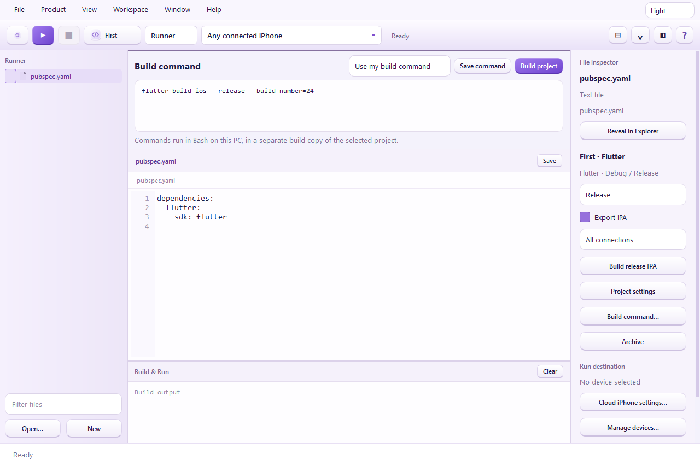
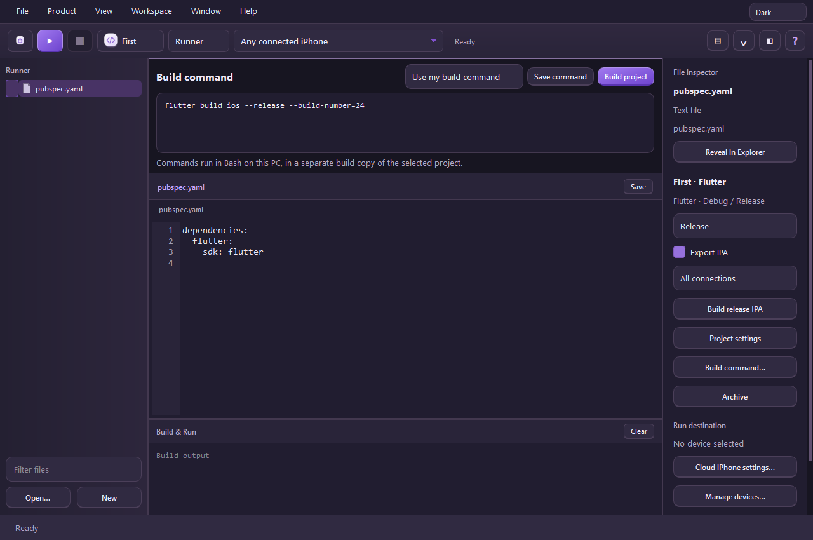

# 🚀 Rano IDE

**A free Windows workbench for building, archiving, signing and uploading supported iOS applications.**

<p align="center"></p>

Rano IDE brings project files, build commands, dependency setup, iPhone connections and App Store Connect delivery into one desktop application. Its supported build paths run locally on Windows through WSL; Rano IDE does not send your project to a build server operated by us.

**Current release: 1.0.4 · Windows x64 · Free to download and use · Application source is private.**

👉 **[Download Rano IDE 1.0.4](https://github.com/hrano1000/Rano-IDE/releases/download/v1.0.4/RanoIDESetup-1.0.4.exe)**

📦 **[All releases and downloads](https://github.com/hrano1000/Rano-IDE/releases)** · 🐛 **[Report a problem](https://github.com/hrano1000/Rano-IDE/issues)** · 📜 **[License](LICENSE)** · 🔐 **[Privacy and security](SECURITY.md)**

This public repository contains the downloads, user documentation, branding and dependency notices. It does not publish the Rano IDE desktop application's development source. GitHub's automatically generated repository ZIP contains these documents; choose the **EXE installer** to install the application.

## 🧭 Contents

- [What Rano IDE does](#-what-rano-ide-does)
- [Supported projects and current limits](#-supported-projects-and-current-limits)
- [Requirements](#-requirements)
- [Download and install](#-download-and-install)
- [Set up missing tools inside the app](#-set-up-missing-tools-inside-the-app)
- [Open a project and use Workbench](#-open-a-project-and-use-workbench)
- [Enter your own build command](#-enter-your-own-build-command)
- [Build settings, Dart defines and scripts](#-build-settings-dart-defines-and-scripts)
- [Check and update dependencies](#-check-and-update-dependencies)
- [Rano IDE help and official links](#-rano-ide-help-and-official-links)
- [Dependencies, plugins and assets](#-dependencies-plugins-and-assets)
- [Build and run on an iPhone](#-build-and-run-on-an-iphone)
- [Create and view archives](#-create-and-view-archives)
- [Set up signing and distribute](#-set-up-signing-and-distribute)
- [Upload output and delivery receipts](#-upload-output-and-delivery-receipts)
- [Versions and build numbers](#-versions-and-build-numbers)
- [Multiple projects and appearance](#-multiple-projects-and-appearance)
- [Clean builds, updates and backups](#-clean-builds-updates-and-backups)
- [Troubleshooting](#-troubleshooting)
- [Privacy, licensing and verification](#-privacy-licensing-and-verification)

## ✨ What Rano IDE does

Rano IDE provides:

- 🛠️ An in-app environment check and installation flow for the supported Windows/WSL development tools.
- 📂 A project chooser, recent projects, file navigator, source editor, line numbers and syntax highlighting for Swift and Dart.
- ⌨️ A prominent **Build command** editor in **Workbench**, with commands saved separately for each project.
- 🧩 Dependency resolution and compatibility checks in separate build copies.
- 📱 Supported development build, signing, install and run workflows for connected iPhones.
- 📦 Local release archives with bundle ID, version, build, SDK information and available matching debug symbols.
- 🔏 Distribution certificate/profile setup and signing of a separate export copy.
- ☁️ Explicit App Store Connect uploads, readable progress output and saved delivery receipts.
- 🪟 Independent project windows and project-scoped archive/IPA/receipt lists.
- 🌗 **System**, **Light** and **Dark** appearance. System is the default.

**Build, archive, export, upload and App Review are different steps.** Building does not automatically upload your app. Uploading a build does not automatically submit it for App Review or publish it on the App Store.

## 🧪 Supported projects and current limits

Rano IDE is a practical development tool with experimental compiler integrations. It is not a complete replacement for every Xcode feature or every iOS project's build tools.

| Project or artifact | What is available in 1.0.4 | What to know before using it |
| --- | --- | --- |
| Flutter | Local Debug/Release iOS builds, release AOT compilation, IPA output, archives and supported iPhone Run workflows | Native plugins must be compatible with the local compiler or a supported adapter. Downloading a package alone cannot make an unsupported native implementation work. Profile builds are not supported. |
| SwiftPM applications compatible with xtool | Local Swift application builds, Debug/Release configuration and existing signing/device workflows | An arbitrary Swift library package is not automatically an installable iOS application. The project needs an appropriate application configuration. |
| Native `.xcodeproj` / `.xcworkspace` | **Experimental** Swift/Objective-C/C++ target builds, configuration files, dependency resolution, resource/script phases and local archives | A SwiftUI application with a local Swift package was built and archived through the Windows UI. Resource and build-tool coverage is incomplete. |
| React Native / Expo | **Experimental** JavaScript dependency installation, Expo native project generation, CocoaPods, code generation, native compilation and release bundling | A React Native 0.87.1 example with a programmatic launch configuration compiled locally. Its stock launch storyboard remains unsupported. Device execution and Apple acceptance of this new path are not yet verified. |
| Existing App Store release IPA | Inspection, project association and the shared delivery workflow, regardless of its original framework | The IPA still needs valid distribution signing, matching metadata and Apple validation. Delivery support does not establish compilation support for its framework. |
| Other folders/frameworks | File browsing and editing; recognized native containers can use the native path | No universal compiler support is inferred from opening a folder or entering a command. |

Use **Check compatibility** beside the Workbench command editor or **Product → Check project compatibility** before a long build. The report reads project metadata and explains known requirements; it does not certify uninstalled dependencies. See the [Windows build and setup audit](docs/COMPATIBILITY.md) for the current evidence and remaining work.

The general native pipeline currently stops on unsupported **storyboards, XIBs, Core Data models, Metal source, string catalogs, newer icon formats, some additional dependency/extension asset catalogs, and App Intents metadata extraction**. Native Xcode/React Native device **Run** is not enabled yet. Some specifically supported Flutter adapters handle their reviewed resources; that does not imply a general-purpose storyboard/XIB compiler.

Unsupported inputs should produce a diagnosis rather than a successful build with missing code or resources. Apple performs the final validation of every uploaded binary.

## 💻 Requirements

You need:

- Windows 10/11 **x64** with support for **WSL 2** and hardware virtualization enabled.
- Internet access for initial tool/SDK/package downloads and Apple services.
- Permission to install required Windows components. Windows may ask for administrator approval and a restart.
- Enough disk space for the toolchain, SDK extraction, dependency caches and your projects. The toolchain flow checks for at least **25 GB** free; SDK import checks the download size plus **40 GB** of extraction/build headroom. These checks are not a maximum storage estimate.
- An iOS SDK obtained independently from Apple under Apple's applicable terms.
- Your own Apple accounts and appropriate developer-program access for signing and App Store Connect delivery.
- A trusted, supported physical iPhone for the implemented device Run workflows; the tested connection path targets iOS 17 or later.

You do **not** need Python installed on Windows to run the EXE. The installer includes the Windows application's runtime. Compilers and development tools are installed/configured separately through **Environment → Automatic setup**.

Automatic setup now checks executable health and SDK resources, detects a Swift/SDK mismatch, and repairs damaged cached Node/native-engine installations. Retry through the setup UI after an interrupted installation.

Large projects and compiler setup can need substantial time, memory and storage. Existing compatible tools and cached downloads are reused where possible.

## 📥 Download and install

The installer shows **Create a desktop shortcut**, checked by default. A Start menu shortcut is also created. Clear the desktop checkbox if you prefer to launch from the Start menu.

1. Download **RanoIDESetup-1.0.4.exe** from the [official release page](https://github.com/hrano1000/Rano-IDE/releases/tag/v1.0.4).
2. Compare the download with the release's **SHA256SUMS.txt** if you want to verify its integrity. On Windows, the file's SHA-256 can be checked with a checksum utility or `Get-FileHash`.
3. Open the EXE and choose **Install & open Rano IDE**.
4. The application installs under your Windows user's local Programs directory and creates desktop/Start menu shortcuts.
5. Open **Environment** and complete the setup described below.

The current EXE is **not Windows code-signed**. A checksum identifies the published file but is not a publisher signature. Use the official repository's release assets; do not install repackaged copies from unknown links. A managed computer may require its administrator's approval.

The portable ZIP is optional. Extract the complete archive and open **RanoIDE.exe**, keeping `_internal` beside it. The EXE by itself inside that ZIP is not a complete portable installation.

Reopening an identical installer can reuse the matching installation. Before replacing an installation that is running, save your work and close that copy. A failed/locked installation should preserve the previous installation.

## 🛠️ Set up missing tools inside the app

1. Open **Environment → Automatic setup**.
2. Select **Check & install missing tools**.
3. Read the component status and installation output. Follow any normal Windows administrator/restart prompts yourself.
4. After a restart, reopen Rano IDE and run the check again. Existing components are detected so setup can resume.
5. If the SDK is missing, choose **Get iOS SDK from Apple**. Sign in to Apple in the embedded browser yourself and select the required Xcode `.xip` download.
6. Allow the download/import/compiler preparation to finish. An already downloaded `.xip` can also be selected through the UI.
7. Check the environment again before starting your first build.

The supported setup flow includes WSL components, a dedicated Ubuntu environment, Swift/xtool, an isolated Flutter toolchain, LLVM/native tools, iPhone/USB tools, release and asset compilers, and native/JavaScript tooling including Node and CocoaPods. Some native compilers are built from pinned source on the first setup and cached afterward.

**Installing the EXE is the first step; it does not silently complete all development setup.** Apple authentication, license acceptance, Windows administrator approval, restarts and hardware/device trust still need the user's input. No external terminal commands are required for the supported setup flow. Unsupported machine policies, network restrictions or third-party build tools may need separate resolution.

The SDK is private to your PC and is **not included in the installer or redistributed by this repository**. The experimental Windows workflow is not an Apple-supported Xcode replacement and does not grant additional rights to use Apple software. Review [Apple's Xcode/SDK agreement](https://www.apple.com/legal/sla/docs/xcode.pdf).

## 📂 Open a project and use Workbench

Choose **Open project** on Home or in the File menu. You can also reopen a recent project. Selecting a Flutter iOS subfolder resolves the owning Flutter project; a React Native iOS subfolder resolves its owning JavaScript application.

Workbench contains:

- **Top toolbar:** Home, Run, Stop, project, scheme/run destination and pane controls.
- **Left:** Project files and file filter.
- **Center:** Build command editor, current source file and Build & Run output.
- **Right:** File information, configuration, build settings and archive controls.
- **Top right:** Appearance selector.



Save source edits before building. The editor warns about unsaved changes and files changed outside the editor. Build progress and errors appear in **Build & Run**. **Activity** provides task output; save sanitized logs only after reviewing them.

## ⌨️ Enter your own build command

The **Build command** editor is visible above the source editor in Workbench.

1. Open the intended project.
2. Paste your complete command or multiline script.
3. The editor selects **Use my build command** when text is entered.
4. Choose **Save command** to retain it, or **Build project** to save and run it.
5. To return to the default, choose **Use the default build**. A blank command uses the default build.

Commands are saved **per project**, not globally. They run in **Bash in the local WSL environment**, in a separate build copy. They are not PowerShell scripts. Windows-only commands need an appropriate tool or adaptation. User scripts have normal access as the configured WSL user; a build copy is not a security sandbox.

### Flutter example

```bash
flutter build ios --release \
  --dart-define=PUBLIC_WEB_URL=https://example.com
```

Supported Flutter `build ios` / `build ipa` commands are translated to Rano IDE's local iOS compiler. Supported flags include release/debug selection, target, flavor, Dart defines, defines files and build name/number. Unsupported flags are reported explicitly; entering a command does not emulate every Flutter/Xcode option.

### Environment values and a multiline script

```bash
export API_URL="https://api.example.com"

flutter build ios --release \
  --dart-define="API_URL=$API_URL" \
  --build-name=1.1.0 \
  --build-number=2
```

Use your own public client configuration. Never embed a server/admin/service-role secret in an application build; app binaries can be inspected.

### Native iOS / React Native example

```bash
xcodebuild \
  -workspace ios/MyApp.xcworkspace \
  -scheme MyApp \
  -configuration Release \
  -destination 'generic/platform=iOS' \
  archive
```

Replace the workspace/scheme with names that exist in your project. Supported `xcodebuild build` / `archive` selections use the experimental local native adapter, not a macOS Xcode executable. Choose an application target in Project settings when the workspace has multiple applications. Rano IDE manages output directories; export/upload commands and arbitrary Xcode options are not supported by this adapter.

### SwiftPM application example

```bash
swift build -c release
```

For an xtool-compatible SwiftPM application, this uses the local app build path. A successful unrelated shell command is not proof that an iOS application was created.

## ⚙️ Build settings, Dart defines and scripts

Open **Project settings** in Workbench. Flutter settings include a Build tab and **Signing & Capabilities**. Native settings include build command and application-target selection.

For Flutter configuration, you can:

- Select a **JSON/JSONC** file containing Dart define values.
- Use **Map JSON values** to map named Dart defines to JSON pointers.
- Use **Use Supabase configuration…** to select a compatible configuration file and map its public client values.

For example, a configuration file may contain:

```json
{
  "vars": {
    "NEXT_PUBLIC_SUPABASE_URL": "https://YOUR_PROJECT.supabase.co",
    "NEXT_PUBLIC_SUPABASE_ANON_KEY": "YOUR_PUBLIC_CLIENT_KEY"
  }
}
```

Map `/vars/NEXT_PUBLIC_SUPABASE_URL` to `SUPABASE_URL` and `/vars/NEXT_PUBLIC_SUPABASE_ANON_KEY` to `SUPABASE_ANON_KEY`, or use the preset. Only selected values become Dart defines. Project configuration is read again on later builds, so changes do not require pasting fixed values into the application.

**Before build** and **After build** select optional Bash `.sh` files:

- **Before build:** Runs preparation commands before compilation.
- **After build:** Runs only after a successful build.
- A failed hook stops the archive workflow; it should not silently claim a complete release.

Hooks run in separate processes. An `export` inside a before-build hook does **not** change the parent build process's environment. Put exports and the build command together in the Workbench command editor, or use the supported configuration/defines-file mapping. Use hooks to generate files or perform other preparation that survives the process boundary.

Relative monorepo configuration and declared local dependencies are preserved inside the staged checkout where supported. Files outside the copied checkout, linked source directories and unsupported tools can still require adaptation.

## 🔄 Check and update dependencies

Use the new **Dependencies** menu in the top menu bar:

1. **Check project dependency updates…** opens the current project's package maintenance dialog.
2. **Check updates** reports package versions in a separate check workspace. The original source manifest and lockfile are retained.
3. **Preview compatible updates** shows the package manager's update plan or compatible version report.
4. **Apply updates** is enabled after a successful preview. It backs up the previous manifests and lockfiles, then applies compatible updates to the current source project. Rebuild and test afterward.
5. **Cancel operation** stops a running package operation. Any saved backup remains available.

Supported update actions: Flutter/Dart `pub`, npm, pinned pnpm, pinned Yarn Classic, and Swift packages with `Package.swift`. Existing version constraints are respected; incompatible major upgrades are not applied automatically. Modern Yarn and native-container dependency updates without `Package.swift` are not covered by this action yet. JavaScript package update actions skip installation scripts; the normal build resolves dependencies afterward. A JavaScript monorepo can share one lockfile, so that lockfile may change even when updating one app.

Backups are saved privately under the app's **dependency-backups** folder, grouped by project and date/time. A failed update retains its backup and is not automatically repeated.

**Check / repair build tools…** opens the supported toolchain setup/repair flow. Compiler versions are pinned for compatibility; reviewed compiler updates arrive with Rano IDE releases. **Update iOS SDK…** opens the SDK update workflow. Package updates and compiler compatibility are different: installing a newer package does not add a missing native implementation.

Package command references: [Dart package updates](https://dart.dev/tools/pub/cmd/pub-upgrade), [npm updates](https://docs.npmjs.com/cli/v11/commands/npm-update/), [pnpm outdated reports](https://pnpm.io/cli/outdated), and [Swift package commands](https://docs.swift.org/latest/documentation/userdocs/commands/).

## 📚 Rano IDE help and official links

**Help → Rano IDE documentation…** opens the built-in, topic-based user guide, including setup, Workbench, commands, dependencies, devices, archives and delivery. The guide works without opening an external documentation site.

**Help → Official Rano IDE GitHub** opens this official repository. **Report a problem** opens our issue tracker. The About page uses the same Rano IDE links. Third-party license and source-access notices remain included.

## 🧩 Dependencies, plugins and assets

Each project resolves its own declared dependencies and versions. Shared tool installations and download caches can be reused, but two projects may legitimately require different package versions and their own native build outputs.

Flutter builds resolve Dart packages before preparing native plugins. React Native builds resolve JavaScript packages, install native dependencies and perform the supported code-generation/bundling steps. Native Swift dependencies retain the project's declared selection and available lockfile pins.

Only empty folders declared as Flutter asset directories are preserved in the separate build copy. Unreferenced empty folders are skipped. Generated/ignored folders still follow the staging exclusion rules.

**Flutter native preparation is automatic for supported packages.** Just choose **Build** or **Archive**. No Project Settings entry is required for the reviewed releases below; the settings table shows **Automatic on build**. The IDE preserves your actual plugin code, privacy resources and relevant locked native dependency versions in the separate build copy. It does not change your Pub cache, drop plugins or silently upgrade your project.

| Newly covered package | Reviewed release |
| --- | --- |
| `disk_space_plus` | 0.2.6 |
| `flutter_inappwebview_ios` | 1.1.2 |
| `flutter_local_notifications` | 18.0.1 |
| `flutter_secure_storage` | 9.2.4 |
| `video_thumbnail` | 0.5.6 |

Existing reviewed native adapters remain available. Unknown or modified releases stop with the affected package and reason, rather than an instruction to fill in an unusable settings field. Use **Help → Official Rano IDE GitHub** for IDE updates or **Dependencies** to preview compatible package updates. Advanced developers can still choose a complete matching SwiftPM package under **Advanced native package overrides**. These adapters do not provide universal CocoaPods or storyboard conversion.


The app's automatic setup installs its supported tooling. It does **not** guarantee that every third-party plugin, CocoaPods package, custom command or macOS-only executable can be installed or compiled on Windows. An unsupported dependency needs a compatible implementation or an explicit adapter.

Messages such as **“newer versions available”** from package resolution are not automatically a failed build. Read the failing phase and the actual compiler error before changing dependency constraints. Do not upgrade every package merely to remove informational notices.

For supported icon catalogs, the pipeline uses your project's original artwork and can generate missing sizes from valid source artwork in a temporary copy. It preserves required icon metadata and device families and checks compiled output. It does not invent a replacement logo when suitable artwork is missing. Unsupported formats/variants must be corrected or adapted.

## 📱 Build and run on an iPhone

For the implemented Flutter/SwiftPM development workflows:

1. Complete environment setup and the appropriate development signing login.
2. Connect and unlock your iPhone.
3. Complete Apple's normal **Trust** and **Developer Mode** steps on the phone yourself.
4. Select the detected iPhone in the run destination menu.
5. If offered, select **Connect iPhone** to connect that Apple USB device to the configured WSL environment. Windows may ask for administrator approval.
6. Select **Run**. The supported path builds, signs, installs and launches the development app.
7. Flutter Debug sessions expose **Hot reload** and **Hot restart** where supported.

**Release** is the default Flutter build configuration; **Debug** is optional for development. An unsigned IPA cannot simply be installed on an iPhone. Development signing and App Store distribution signing are different workflows.

Windows does not run Apple's local iOS Simulator. The Simulator setup entry explains that limitation. The optional **Appetize** cloud-iPhone integration uses your own external provider account and supported simulator artifacts; provider quotas/prices apply. It is not required for local builds or App Store delivery.

## 📦 Create and view archives

Choose **Product → Archive** or **Archive** in Workbench to build a new local release archive. When the build finishes, the organizer displays its app identity, version/build, timestamp, SDK metadata and available matching symbols.

To see builds you already have, choose **View → Archives**. Viewing archives does **not** rebuild the project.

The organizer contains:

- **Local archives:** Select an archive, inspect its details, open its folder or begin distribution.
- **Release IPAs:** Select an existing signed export and inspect/upload it.
- **App Store account:** Connect your organization's App Store Connect API credentials.
- **Delivery receipts:** Review saved delivery states and check a selected delivery later.

Archives, release IPAs and receipts are associated with the current project. Existing history is recovered automatically when its metadata/source links identify the project reliably. Ambiguous records are kept rather than shown under the wrong project; manual import/association remains available when automatic identification is insufficient. Imports copy/record supported artifacts without rebuilding their source.

## 🔏 Set up signing and distribute

You need your own Apple Developer/App Store Connect access, an app record with the correct bundle ID, and signing assets authorized for the app and its extensions.

1. Select a completed archive.
2. Open **Signing setup**.
3. Connect the required App Store Connect API account using your **Key ID**, **Issuer ID** and `.p8` key in the app's secure account UI.
4. Use **Retrieve existing assets**, **Set up automatically**, or manual import as appropriate. Automatic creation may require additional Apple permissions. Existing certificates are useful only when their matching private keys are available; Apple cannot return a lost private key.
5. Confirm the distribution certificate, team, expiration and profiles for the app and extensions.
6. Select **Done**, then **Distribute App…**.
7. Choose **App Store Connect** or **Export App Store IPA locally**. Inspect the version/build and continue.
8. Choose an export location. The signer works on a separate copy and verifies the result. The source archive is retained.

Saved credentials and valid signing assets are reused. You normally do not repeat setup for every upload. New bundle IDs/extensions, changed capabilities, expiry, revoked assets, different teams or lost credentials can require new setup.

For App Store Connect delivery, select the matching Apple app in **Release IPAs**, use **Check before upload**, review the result and select **Upload…** with the explicit confirmation. A local export does not upload by itself.

Apple's membership requirements, app-record rules, permissions, agreements and signing restrictions still apply. Rano IDE does not bypass those controls.

## ☁️ Upload output and delivery receipts

**Upload output** shows stages such as metadata inspection, release-version checks, checksum computation, upload/file record creation, chunk transfer, checksum/completion acknowledgment and subsequent Apple processing state.

Transfer completion means Apple received the file. **Processing** means Apple has not completed build validation yet. **Complete** is not App Review approval and is not public release.

Receipts preserve available upload/file identifiers and states. Read-only status checks stop after a bounded checking period or on a terminal/error state; reopen the receipt and choose **Check selected delivery** to check again later.

Interrupted or uncertain submissions are **not automatically re-uploaded**. Check the existing receipt and App Store Connect before creating a duplicate upload. Apple may return final warnings/errors after a transfer that initially succeeded.

## 🔢 Versions and build numbers

Rano IDE's **1.0.4** version is separate from your application's version.

- Flutter normally gets app version/build from `pubspec.yaml` and supported build overrides.
- Native Xcode projects use their selected configuration's marketing/build settings.
- The distribution dialog offers explicit **Version** and **Build number** fields for the export copy.
- **Manage build number automatically** checks occupied build numbers and adjusts on a clash; it should not increment every build unnecessarily.

Increasing the build number does not reopen an Apple release train whose marketing version is closed. If Apple reports **90186 / 90062**, select a higher marketing version as required and create/export a corresponding new build. Changing the desktop version never changes your app's release train.

## 🪟 Multiple projects and appearance

Use **File → New Window** or **Open Project in New Window** to work on another project. Use **Window** to switch workbenches. Each project window has its own files, unsaved edits, output, build state, destination and organizer. Accounts/signing assets and appearance preferences are shared where appropriate.

The top-right selector offers **System**, **Light** and **Dark**. System follows Windows and is the default on a fresh installation. A manual choice is saved and applied across project windows.



## 🧹 Clean builds, updates and backups

Use **Product → Clean Build** to remove managed build data before rebuilding. Read the scope and selected options before confirming. Dependency caches, saved archives and exported IPAs are separate choices where offered; deleting generated builds is different from deleting an archive you want to retain.

Cleanup does not remove builds from Apple, revoke certificates or uninstall your app from an iPhone. Do not use it as a substitute for diagnosing a compiler error. Externally imported artifacts and user source directories are outside the normal managed cleanup scope.

For an update, download the new official installer, save your work and close the installation being replaced. Earlier desktop project/account storage is retained so renaming to Rano IDE does not require importing every artifact again. Back up important source projects, archives and signing material independently.

Protected credentials are tied to the Windows user account. Copying an encrypted profile to another PC/user is not a reliable signing-key backup. Use supported secure backup/export options and store them privately.

## 🩺 Troubleshooting

| What you see | What to check |
| --- | --- |
| Missing WSL/toolchain/SDK | Open **Environment → Automatic setup**, check/install missing tools and import the SDK. Follow restart/admin prompts yourself. |
| First setup or dependency stage takes a long time | Read the current phase/output. First-time source compiler builds and package downloads can be slow; later runs reuse caches. Do not start another concurrent build to guess whether the first is active. |
| Package/plugin not supported | Check the named package/version and native implementation. A compatible package/adapter may be needed; `pub get` alone cannot supply a missing native compiler feature. |
| Unsupported storyboard/XIB/Metal/Core Data resource | The general native compiler does not support that resource yet. Use a compatible project configuration/implementation or wait for a verified adapter. Do not delete functional resources merely to force a build to pass. |
| Build workspace preparation fails | The default command does not cause this error. Read the affected file and reason in Build & Run. Version 1.0.2 and later handle long Windows paths, exclude generated monorepo caches and keep partial copies cleanable. Use **Product → Clean Build** for damaged copies; resolve a reported disk-space or access issue before retrying. |
| Custom command fails | Confirm the selected project, Bash syntax, relative paths, installed tools and supported flags. Put required environment values in the same script as the build or use configuration mappings. |
| Archive list is empty | Ensure the selected project actually completed an archive build. A failed build creates no new archive. **View → Archives** only displays existing history. |
| Certificate/profile validation fails | Check team, private-key availability, expiry, bundle/extension IDs, certificate authorization and capabilities in **Signing setup**. |
| Upload button is disabled | Select a valid release IPA, connect the API account, refresh matching apps and choose the matching destination. Review the actual prerequisite/status message. |
| Duplicate/conflicting build | Check the existing version/build in Apple and use the explicit or automatic build-number controls. Do not submit the same occupied combination again. |
| Closed release train: 90186 / 90062 | Use a marketing version higher than the approved/closed version as Apple requires; a build-number-only change is insufficient. |
| Missing icons: 90022 / 90023 / 90713 | Check original artwork, required sizes, device-family declarations and app-icon metadata. Build a fresh corrected artifact and inspect it before another upload. |
| Invalid `Assets.car`: 90562 | Review catalog compilation/validation output. Use the current supported compiler and build a new artifact; do not substitute an empty/fake catalog. |
| Upload interrupted or outcome uncertain | Save/review sanitized output and the retained receipt. Check Apple before retrying. Automatic mutation retries are deliberately avoided. |
| Apple stays in Processing | Review App Store Connect's build details, errors/warnings and account email. Check the receipt again later. If prolonged, contact Apple with the app/version/build and sanitized upload details; avoid repeatedly uploading the same file. |
| iPhone missing or Run fails | Unlock/trust the device, enable Developer Mode as required, verify USB forwarding and development signing, and use a workflow whose Run support is implemented. |

When reporting a problem, include the Rano IDE version, Windows version, framework/tool versions, failing stage, sanitized error text and a safe screenshot. Never attach private keys, tokens, passwords, full signing backups or your entire private project. See [SECURITY.md](SECURITY.md).

## 🔐 Privacy, licensing and verification

Builds run locally through WSL in separate project copies. Rano IDE does not require a backend service hosted by us. Apple API keys and distribution private keys are stored using Windows current-user protection. Local archives, caches and logs can contain sensitive project information; protect them like your original project.

Your computer contacts external services when required: tool/package providers for downloads, Apple for SDK/account/signing/delivery operations, and Appetize only when you choose its integration. Uploading an IPA to Apple sends the compiled application and its assets to Apple. Building locally does not automatically upload it.

Rano IDE is **freeware with private application source**. Included/downloaded third-party components retain their licenses and source-access rights. Qt is dynamically packaged so compatible libraries can be replaced and modified-library debugging remains permitted. Some independent backend scripts/patches are source-available under their own licenses. Keeping application source private is not a promise that executable contents or embedded helper scripts cannot be inspected.

Read [LICENSE](LICENSE), [THIRD_PARTY_NOTICES.md](THIRD_PARTY_NOTICES.md) and [DEPENDENCY_SOURCE_ACCESS.md](DEPENDENCY_SOURCE_ACCESS.md). Apple SDKs, project sources, credentials, signing profiles and developer build caches are excluded from the published release assets.

Read the [full 1.0.4 audit](docs/AUDIT-1.0.4.md) for findings, verification and remaining limits.

For 1.0.4, **619 automated checks passed**, with **27 environment-dependent/opt-in checks skipped**. All five newly supported legacy plugins compiled together in a real iOS ARM64 release build on Windows/WSL, including their native implementations, WebP encoding dependency and privacy resources. Compilation passed with both default and reviewed locked native dependency selections. The actual Workbench release IPA build passed. Empty asset-directory staging has additional regression coverage. No Apple upload or new device runtime test was performed for these changes. Release packaging requires frozen application checks, isolated installer verification and credential scans. Previous 1.0.2 auditing also covered a real dependency update and native SwiftUI archive through the UI. **A completely clean Windows VM installation with the full toolchain remains unverified.** Native/React Native support retains the limits described above.

🧡 **Try it, keep your source and credentials private, and report reproducible problems so the tool can improve for everyone.** Rano IDE is independent and is not affiliated with or endorsed by Apple, Flutter, React Native, Qt or the underlying tool maintainers.
